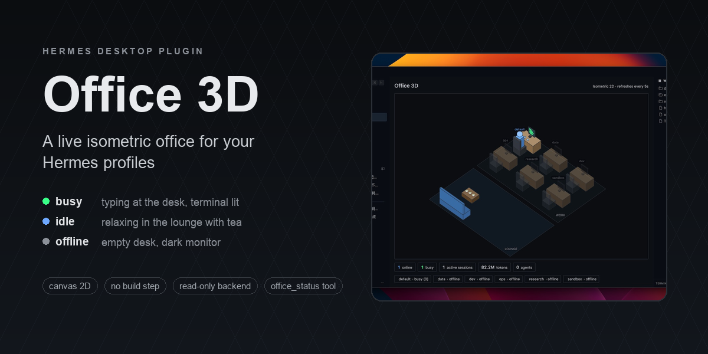
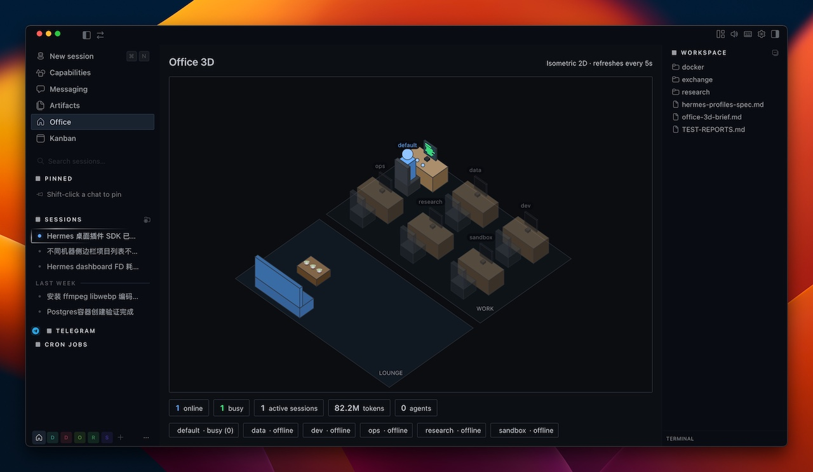
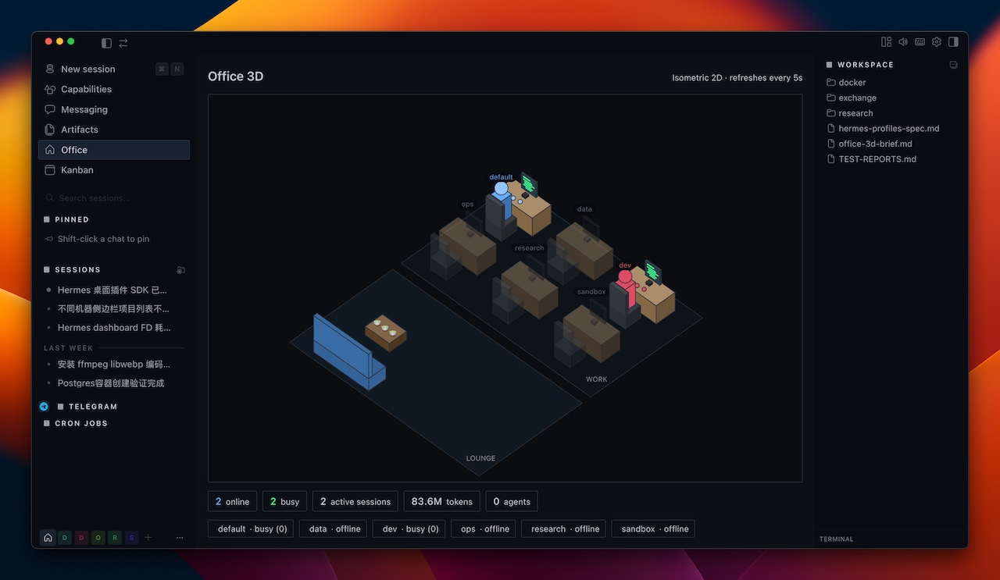

# office-3d — a live isometric office for Hermes Desktop

A Hermes Desktop plugin that renders your Hermes **profiles as people in an isometric office**. Each profile owns a desk; when a profile is doing real work it sits at its desk typing with a green terminal screen, when it's online but idle it relaxes in the lounge with tea 🍵, and when it's offline its desk sits empty with a dark monitor. A slim stats bar shows aggregate active sessions, tokens, and cost.

English | [中文](./README.zh-CN.md)

## Screenshot






## What it shows

| State | Meaning | In the office |
|---|---|---|
| **busy** | the profile has a session active in the last ~90s (real work) | person typing at the desk, green code on screen |
| **idle** | online but no recent session activity | person in the lounge holding tea 🍵 |
| **offline** | no live process / no recent activity | empty desk, dark monitor, dimmed name |

- Follows the Hermes light/dark theme automatically.
- The overview counts enabled profiles, including offline ones even when offline desks are hidden.
- Backend reads only aggregate columns (COUNT/SUM/MAX) from each profile's `state.db` — never message contents.

## Beyond the page

- **Click a desk** (or a leaderboard row) to inspect that profile: a detail panel with its state,
  active/open sessions, agents, tokens, cost and idle time, plus **Open chat** and — when the
  profile has one — **Open latest session**.
- **Cost / tokens leaderboard** in the right-hand column, switchable between the two, ranked
  descending; click a row to inspect that profile.
- **Status-bar chip** — an always-mounted summary at the right end of the status bar
  (`🏢 2 busy` when something is working, otherwise `🏢 4 online`). Click it to open the office.
  Hover for the full breakdown.
- **⌘K palette command + keybind** — "Open Office 3D", bound to `mod+shift+o` by default and
  rebindable in Settings.
- **`office_status` agent tool** — read-only. Reports which profiles are online, busy or
  offline with aggregate session / token / cost totals, so the model can answer "who is
  working right now?" without the Desktop app. Same privacy boundary as the backend.
- **Settings ▸ Plugins ▸ Office 3D** — refresh interval (2s / 5s / 15s / 60s), hide offline
  profiles, choose visible profiles (including `default`), and opt in to state-change notifications.
  All profiles, including newly discovered ones, are enabled by default. The profile switches
  remain available for offline profiles and persist in Desktop's plugin storage, shared across
  profiles in that client. They affect only this UI, not gateways or the `office_status` tool.
  Disabled profiles are excluded from the office, details, overview, status chip and notifications.
  The status chip and notifications also apply the hide-offline filter; newly visible profiles
  seed notification state rather than triggering a toast. The overview still counts enabled
  offline profiles, even when their desks are hidden.

## Built with

- **@hermes/plugin-sdk** — Hermes Desktop plugin API (single-file ESM, no build step)
- **Canvas 2D** — hand-rolled isometric projection (no WebGL / three.js)
- **React** via the SDK's jsx runtime — `useQuery` polling + canvas lifecycle
- **Python + FastAPI** — read-only dashboard backend at `/api/plugins/office-3d/`
- **SQLite** (read-only, stdlib only) — per-profile session / token / cost aggregates

## Repository layout

This repo is a single **unified package** — one installable folder that ships both halves:

```
plugin.yaml                 # manifest (name, version, description, platforms)
__init__.py                 # agent half — the read-only office_status tool
desktop/plugin.js           # desktop half — the canvas office page, sidebar nav,
                            # status-bar chip, palette command + keybind, settings page
dashboard/manifest.json     # dashboard backend manifest
dashboard/plugin_api.py     # FastAPI router -> /api/plugins/office-3d/state
docs/                       # screenshots
```

When the folder lands in a `plugins/` root, the Desktop app copies `desktop/plugin.js` into `$HERMES_HOME/desktop-plugins/office-3d/` itself, so one folder is the whole install. The desktop half degrades gracefully (an error, not a crash) when the backend half is disabled.

## How it works

1. **Desktop half** — `desktop/plugin.js` — a single ESM file the desktop app loads at runtime (canvas 2D isometric scene; no build step).
2. **Backend half** — `dashboard/plugin_api.py` + `manifest.json` — a FastAPI router mounted at `/api/plugins/office-3d/state` by the dashboard web server. It uses Hermes gateway liveness resolution, including multiplexed profiles, and reads `gateway_state.json` and `state.db` for status and session activity + token/cost aggregates. Recent active sessions also mark a profile online.
3. **Enable flag** — `office-3d` must be listed in `plugins.enabled` in your `config.yaml` before the backend is imported (security gate). `hermes plugins enable office-3d` writes it.
4. **Agent half** — `__init__.py` registers one read-only tool, `office_status`, which scans the same two sources directly from the gateway process (no HTTP, no credentials).

The plugin uses Hermes's `get_default_hermes_root()` to find the fleet root, including custom roots and named-profile processes; profile names are discovered under that root. The Python halves require a Hermes build providing that helper (the existing `>=0.20.0` manifest constraint alone does not guarantee it); they fail explicitly if it is unavailable. The desktop half requires the SDK's `host.state.connectionId`, `gatewayActivationEpoch` and `useGatewayActivationEpoch` APIs. Switching profiles does not enable the backend: each serving profile must independently authorize the plugin, otherwise requests can return 404.

## Install

### From the catalog (once listed)

```bash
hermes plugins install office-3d
hermes plugins enable office-3d
```

### From this repository

```bash
hermes plugins install oslook/hermes-desktop-plugin-office-3d
hermes plugins enable office-3d
```

### Manual

```bash
git clone https://github.com/oslook/hermes-desktop-plugin-office-3d.git
cp -R hermes-desktop-plugin-office-3d "${HERMES_HOME:-$HOME/.hermes}/plugins/office-3d"
hermes plugins enable office-3d
```

`install.sh` does the same thing and honours `$HERMES_HOME`:

```bash
bash install.sh
```

Then make it take effect:

- **Desktop half**: fully quit and reopen the Hermes Desktop app (or ⌘K → **Reload desktop plugins**), then open the **Office** page from the sidebar.
- **Backend half**: restart the dashboard web server so it mounts `/api/plugins/office-3d/`. If you run `hermes dashboard`, stop and start it again. (On a LAN/LaunchAgent setup, restart that service.)

## Requirements

- Hermes Desktop **0.20.0+** — the desktop app is required; the CLI/gateway alone does not load desktop plugins. (Developed on 0.20.0.)
- The dashboard web server running (it serves `/api/plugins/...`).
- **Linux or macOS.** Windows support has not been validated; the manifest declares `platforms: [linux, macos]`.

## Uninstall

```bash
hermes plugins remove office-3d
```

Then reload desktop plugins / restart the dashboard.

## Privacy

The backend opens each profile's `state.db` **read-only** and runs only aggregate queries (COUNT/SUM/MAX) over the `sessions` table — session counts, token totals, cost, and last-activity time. It never reads message content, system prompts, or titles. It makes no network calls and needs no credentials.

## License

MIT — see [LICENSE](./LICENSE).
