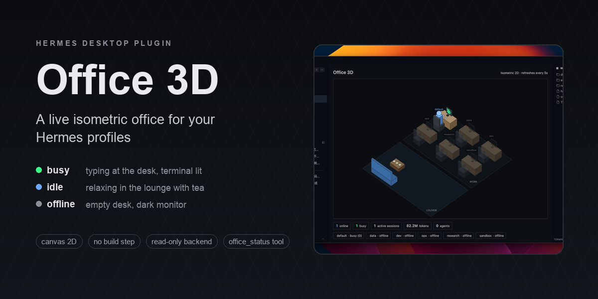
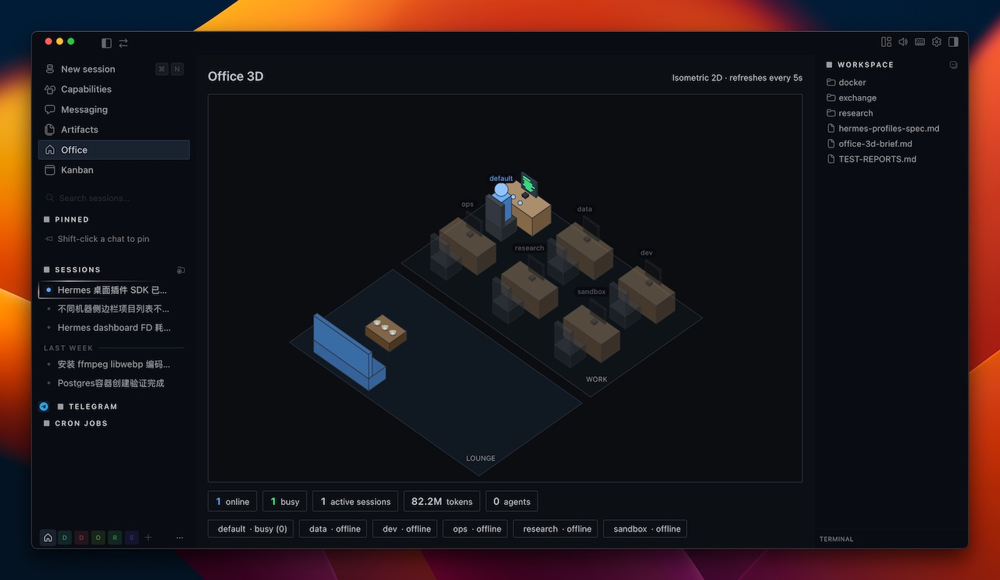
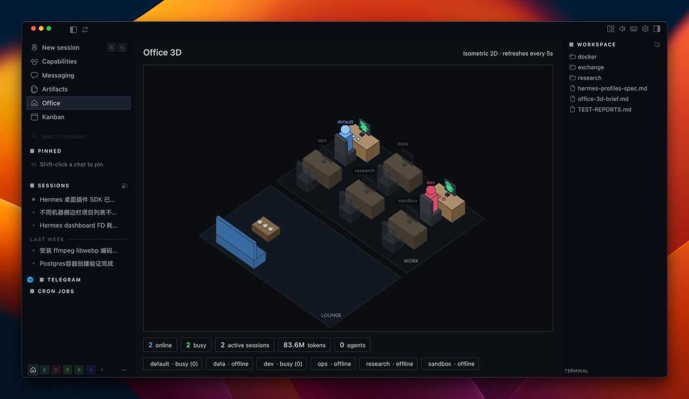

# office-3d — Hermes 桌面端的实时等距办公室

一个 Hermes 桌面插件，把你的 Hermes **各个 profile 渲染成等距（isometric）办公室里的小人**。每个 profile 有自己的工位：真正在干活时坐在工位敲键盘、显示器亮着绿色代码；在线但空闲时到休息区喝茶 🍵；离线时工位空着、显示器熄灭。底部有一条状态栏，聚合显示所有 profile 的活跃会话数、token 数、成本。

[English](./README.md) | 中文

## 截图






## 展示内容

| 状态 | 含义 | 办公室里的表现 |
|---|---|---|
| **busy（忙）** | 该 profile 最近约 90 秒内有活跃会话（真在干活）| 小人在工位敲键盘、屏幕跳绿色代码 |
| **idle（空闲在线）** | 在线但近期无会话活动 | 小人在休息区端着茶 🍵 |
| **offline（离线）** | 无存活进程 / 无近期活动 | 空工位、显示器熄灭、名字变暗 |

- 自动跟随 Hermes 的明暗主题。
- 底部状态徽章：**online / busy / 活跃会话 / tokens / agents / cost**，跨所有 profile 聚合。
- 后端只读各 profile `state.db` 的聚合列（COUNT/SUM/MAX），**绝不读会话正文**。

## 页面之外

- **点击工位**（或榜单行）查看该 profile：详情面板显示状态、活跃/未结束会话、agents、tokens、成本、空闲时长，并提供 **Open chat** 与（该 profile 有时）**Open latest session**。
- **成本 / tokens 榜单**在右栏，可在两者间切换、降序排名；点行即查看该 profile。
- **状态栏挂件** —— 常驻在状态栏右端的小结（有活在跑时显示 `🏢 2 busy`，否则 `🏢 4 online`）。点击打开办公室，悬停看完整分解。
- **⌘K 命令面板 + 快捷键** —— "Open Office 3D"，默认 `mod+shift+o`，可在设置里改绑。
- **`office_status` agent 工具** —— 只读。报告各 profile 的 online/busy/offline 与聚合的会话数/token/成本，让模型无需桌面 app 就能回答"现在谁在干活"。隐私边界与后端一致。
- **设置 ▸ 插件 ▸ Office 3D** —— 刷新间隔（2s / 5s / 15s / 60s）、隐藏离线 profile、可选的"profile 状态变化时弹通知"。

## 技术栈

- **@hermes/plugin-sdk** — Hermes 桌面插件 API（单文件 ESM，无需构建）
- **Canvas 2D** — 手写等距（isometric）投影（不用 WebGL / three.js）
- **React**（经 SDK 的 jsx runtime）— `useQuery` 轮询 + canvas 生命周期管理
- **Python + FastAPI** — 只读的 dashboard 后端，挂载于 `/api/plugins/office-3d/`
- **SQLite**（只读，仅标准库）— 各 profile 的会话 / token / 成本聚合

## 仓库结构

本仓库是一个**统一包（unified package）**——一个可安装目录同时带上前后端两半：

```
plugin.yaml                 # 清单（name / version / description / platforms）
__init__.py                 # agent 半边 —— 只读的 office_status 工具
desktop/plugin.js           # 桌面端半边 —— canvas 办公室页面、侧栏导航、
                            # 状态栏挂件、命令面板命令 + 快捷键、设置页
dashboard/manifest.json     # dashboard 后端清单
dashboard/plugin_api.py     # FastAPI 路由 -> /api/plugins/office-3d/state
docs/                       # 截图
```

该目录落到 `plugins/` 根下后，桌面 app 会**自己**把 `desktop/plugin.js` 复制到 `$HERMES_HOME/desktop-plugins/office-3d/`，所以一个目录就是完整安装。后端半边未启用时，桌面半边会优雅降级（报错而非崩溃）。

## 工作原理

1. **桌面半边** — `desktop/plugin.js` — 桌面 app 运行时加载的单个 ESM 文件（canvas 2D 等距场景，无需编译）。
2. **后端半边** — `dashboard/plugin_api.py` + `manifest.json` — 一个 FastAPI 路由，由 dashboard web 服务挂载到 `/api/plugins/office-3d/state`。它扫描每个 profile 的 `gateway_state.json`（进程存活）和 `state.db`（会话活动 + token/成本聚合）。
3. **启用开关** — 后端被 import 前，`office-3d` 必须出现在 `config.yaml` 的 `plugins.enabled` 里（安全门）。用 `hermes plugins enable office-3d` 写入。
4. **agent 半边** — `__init__.py` 注册一个只读工具 `office_status`，在 gateway 进程里直接扫描同样的两个数据源（不走 HTTP、不需要凭据）。

插件可移植：`HERMES_HOME` 会优先读环境变量 `$HERMES_HOME`（回退 `~/.hermes`），profile 通过扫描 `~/.hermes/profiles/` 动态发现——**不写死任何 profile 名字**。

## 安装

### 从 catalog 安装（上架后）

```bash
hermes plugins install office-3d
hermes plugins enable office-3d
```

### 从本仓库安装

```bash
hermes plugins install oslook/hermes-desktop-plugin-office-3d
hermes plugins enable office-3d
```

### 手动安装

```bash
git clone https://github.com/oslook/hermes-desktop-plugin-office-3d.git
cp -R hermes-desktop-plugin-office-3d "${HERMES_HOME:-$HOME/.hermes}/plugins/office-3d"
hermes plugins enable office-3d
```

`install.sh` 做同样的事，并遵循 `$HERMES_HOME`：

```bash
bash install.sh
```

然后让它生效：

- **桌面半边**：彻底退出并重开 Hermes 桌面 app（或 ⌘K → **Reload desktop plugins**），再从侧栏打开 **Office** 页面。
- **后端半边**：重启 dashboard web 服务，让它挂载 `/api/plugins/office-3d/`。如果你用 `hermes dashboard`，停掉再启动即可。（若是 LAN/LaunchAgent 部署，重启对应服务。）

## 前置要求

- Hermes Desktop **0.20.0+** —— 必须有桌面 app；只有 CLI/gateway 不会加载桌面插件。（在 0.20.0 上开发。）
- dashboard web 服务在运行（它才提供 `/api/plugins/...`）。
- **仅支持 Linux / macOS。** 不支持 Windows：后端用 `os.kill(pid, 0)` 判断 profile 进程是否存活，而在 Windows 上除 `CTRL_C_EVENT`/`CTRL_BREAK_EVENT` 外的任何信号都会走 `TerminateProcess`，会**直接杀掉**目标进程（即 gateway）。清单里因此声明了 `platforms: [linux, macos]`。

## 卸载

```bash
hermes plugins remove office-3d
```

然后重载桌面插件 / 重启 dashboard。

## 隐私说明

后端以**只读**方式打开每个 profile 的 `state.db`，只对 `sessions` 表跑聚合查询（COUNT/SUM/MAX）——会话数、token 合计、成本、最近活动时间。**不读取消息正文、system prompt 或标题**。不发起任何网络请求，不需要任何凭据。

## 许可证

MIT — 见 [LICENSE](./LICENSE)。
